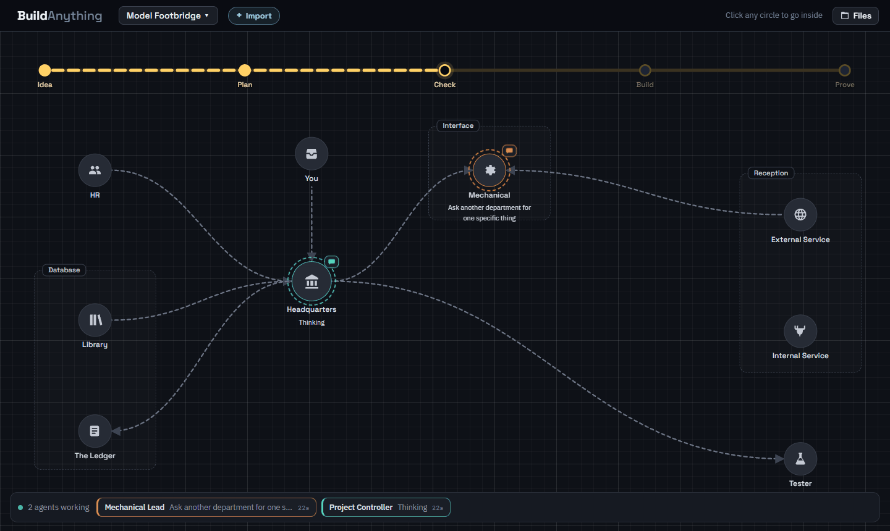
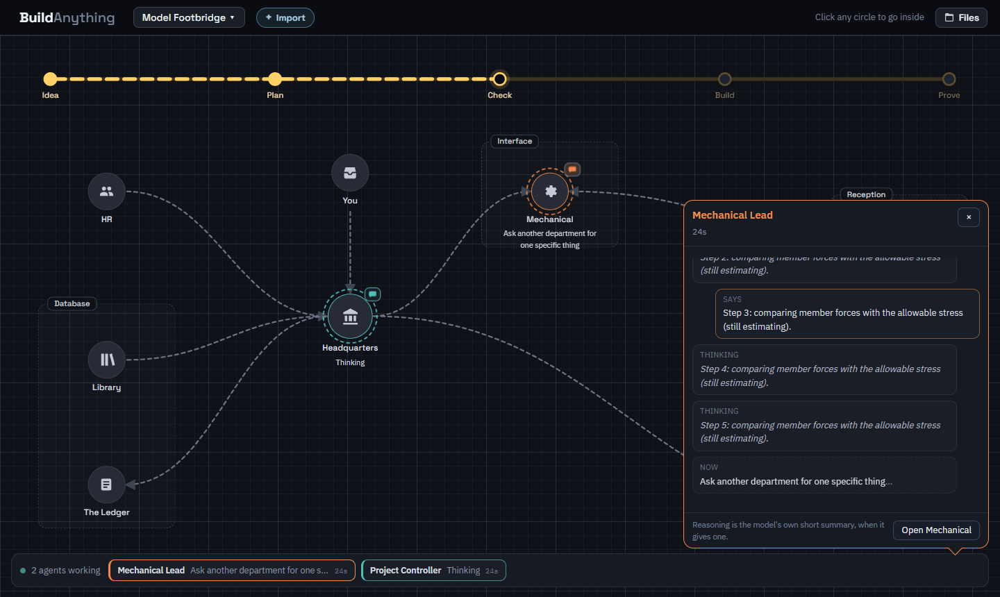
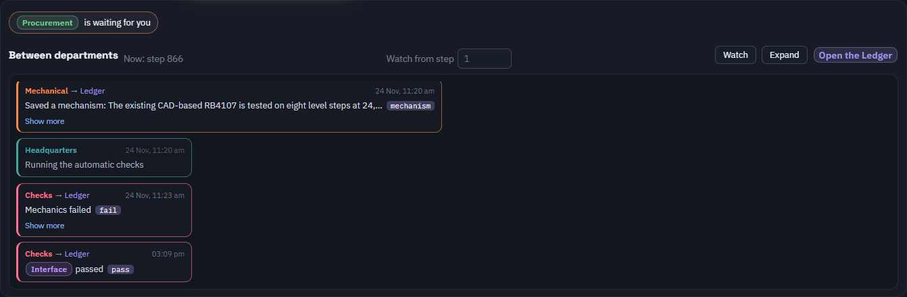
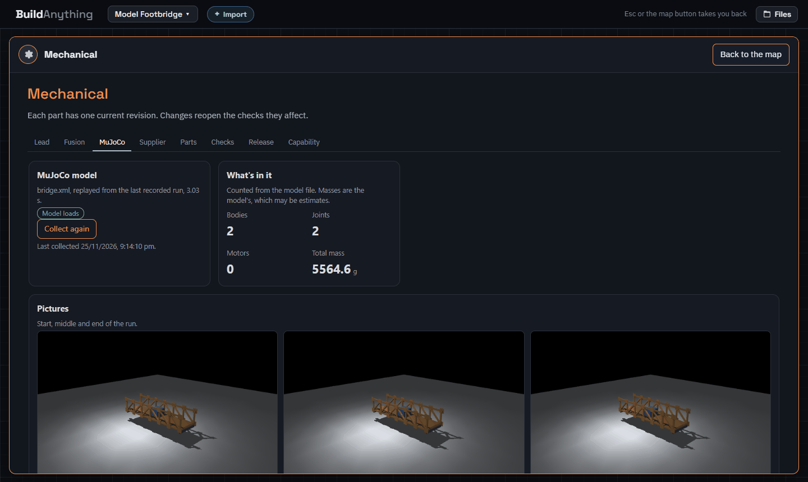
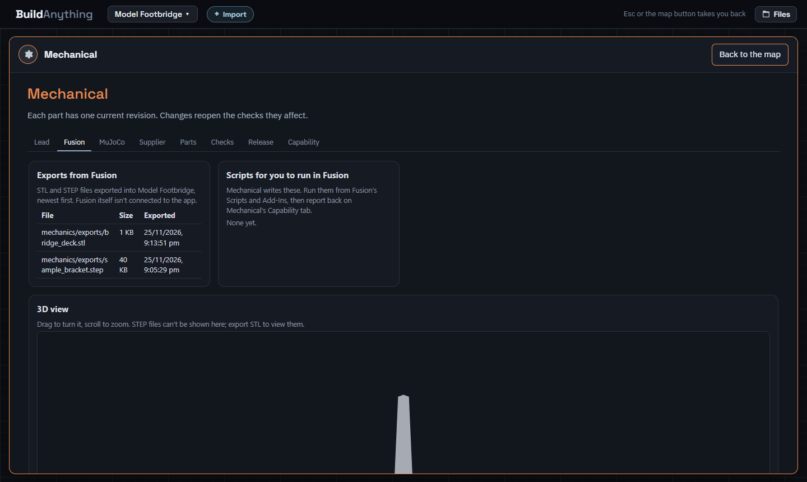
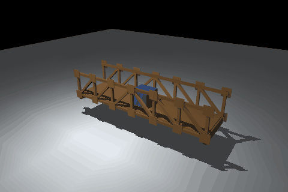
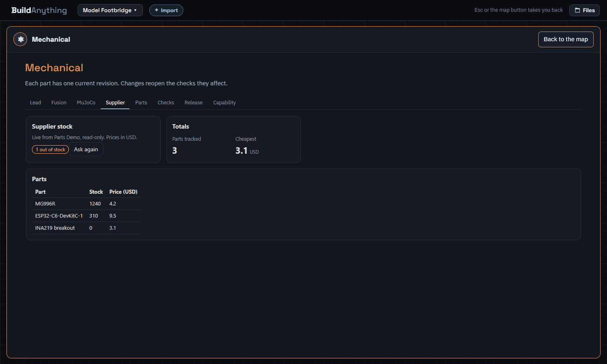
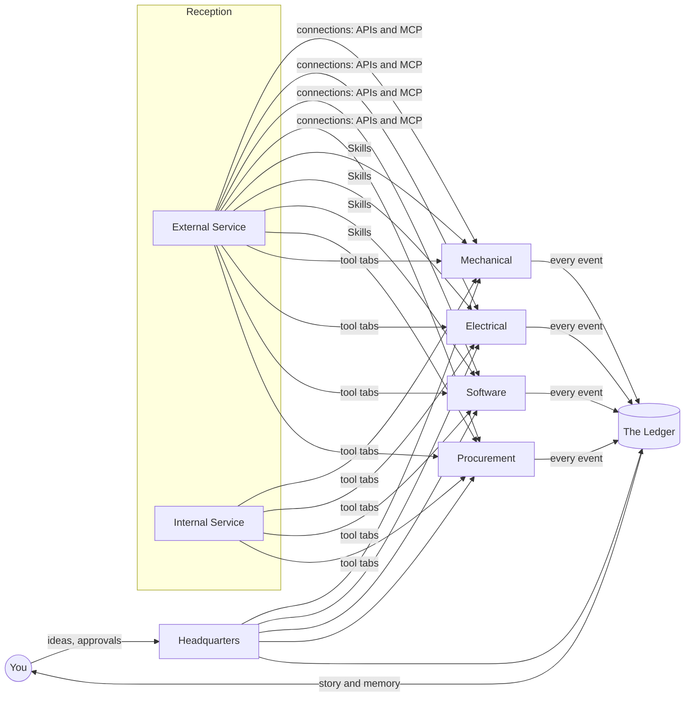
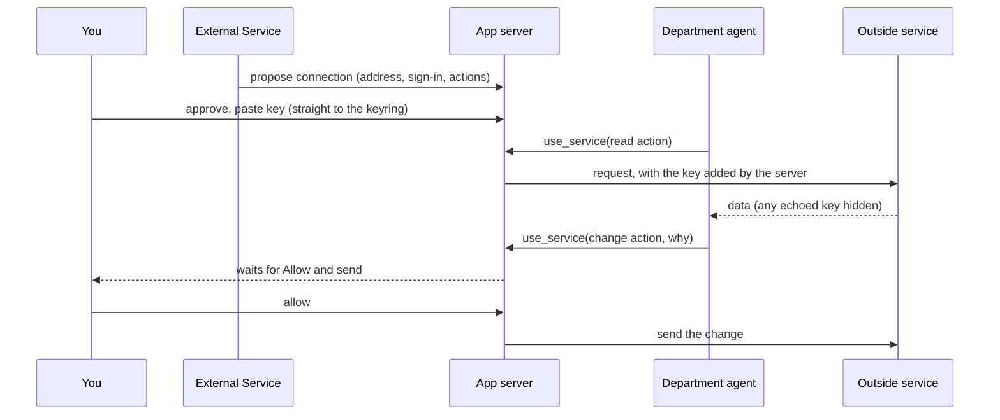

# BuildAnything

**An AI team that takes a hardware or software project from an idea to a proven device, with you approving every step that matters.**

You describe what you want to build. Headquarters proposes only the departments and gates the project needs (Mechanical, Electrical, Software, Procurement), and each department's lead agent does the work: parts, circuits, firmware, prices, tests. Everything they do goes into one record, the Ledger. Agents propose; you decide. Nothing is approved, installed, flashed, bought or changed in your design without you.

<p align="center">
  
</p>

---

## Contents

- [Features](#features)
- [How it fits together](#how-it-fits-together)
- [User guide](#user-guide)
- [Proof: what was built and checked](#proof-what-was-built-and-checked)
- [Safety model](#safety-model)
- [Project layout](#project-layout)

---

## Features

### See who's working, and what they're thinking

The home canvas shows every agent that's running right now. A busy node gets a turning dashed ring in its own colour, a status bar along the bottom lists each agent with its current step and how long it's been running, and the speech-bubble button opens a live chat-style trail: the model's reasoning summaries, each tool it uses (and with what), and what it says.

| The canvas while two agents work | One agent's live trail |
|---|---|
|  |  |

### The Ledger: the story, and the project's memory

Every event is recorded. The **Story** tab replays it as a conversation between the team, with timestamps and each department in its own colour. Click a message to read it in full. It always opens on the current step, and **Watch from step [n]** replays from any point until you press **Stop**. The **Memory** tab draws what the project knows as a graph (requirements, tests, design needs, parts, connections, code, decisions, sourced facts) and shows, for any item, what it depends on and what a change to it would affect.

| Story, with the conversation | Memory: what depends on what |
|---|---|
|  |  |

Headquarters shows the same conversation, compact, under **Between departments**:



### Tool tabs: any tool, in the department that uses it

Service agents can write a **tool tab**: a TSX tab in a department's screen that shows one tool's results for the open project. Guided by the built-in Tab-creator and Card-creator Skills, they can make a tab for any tool: CAD, physics simulation, PCB rule checks, MATLAB, data and plots. The app compiles each tab and runs it in a sealed frame with no network access and no access to the app's buttons. An optional data script runs in a sandbox, only if you switch tab scripts on. You approve each tab and choose which projects show it.

| MuJoCo tab (replays the recorded run) | Fusion tab (exports in 3D, scripts to run) |
|---|---|
|  |  |

<p align="center"><br><sub>The model footbridge under a 5 kg block, simulated in MuJoCo by the Simulation Engineer's sandboxed run.</sub></p>

The examples that ship with the Skill: **Fusion**, **MuJoCo**, **KiCad** (ERC and DRC through kicad-cli), **MATLAB** (batch run, figures) and **data and plots** (CSV statistics).

### Connections: use any online service or MCP server

External Service connects the app to outside services, such as Altium 365 through Nexar, GitHub, supplier APIs and MCP servers:

- **Setup:** it researches the official documentation and proposes a connection: the address, how you sign in, setup steps, and a list of named actions, each marked *reads* or *changes something*.
- **Your part:** you approve it, then paste the key (or press **Sign in** for browser sign-in), and press **Test**.
- **Use:** department agents then call it by themselves. Reading runs at once; every change waits for your **Allow and send**. Tool tabs can show its data live.

| A connection at External Service | A tab showing a connection's live data |
|---|---|
|  |  |

<sub>Shown against a stand-in service running on this computer, during testing.</sub>

### Reception: Skills, tool tabs, project environments

- **External Service** writes **Skills**: guides for programs you operate yourself, such as Altium, researched from official sources, checked by the app and an independent reviewer, and approved by you. It also keeps your AI provider settings.
- **Internal Service** looks after each project's own Python environment (it proposes installs; you approve them) and the app's file viewers.
- **Tool tabs** are reviewed, previewed, approved and shown per project here, with one switch for data scripts.


### Files, with viewers

A file explorer on the right, which you can drag to resize, lists everything in the project, with viewers for PDF, Markdown, JSON, XML, CSV and XLSX, and STL in 3D. For other types, the Platform agent can write a sandboxed converter, which you approve.


### A team shaped to the project

Headquarters proposes only the departments a project needs, and gates with their own criteria, instead of a fixed pipeline. Departments that aren't on the team are hidden. Switching projects closes any screen the new project doesn't have.

---

## How it fits together



How an outside service is used:



**Stack:** a React 18 + Vite app (`app/`), a FastAPI backend (`backend/`) running the agents through the OpenAI Agents SDK, with fastmcp for MCP, esbuild for tool tabs, and MuJoCo for simulations. All data stays in local folders, and the servers listen on this computer only (127.0.0.1).

---

## User guide

### 1. Install

You need **Windows**, **Python 3.11+** with [uv](https://docs.astral.sh/uv/), **Node.js 20+** (built and tested on Node 22), and **Chrome or Edge**.

```bash
git clone https://github.com/Lynean/BuildAnything.git
cd BuildAnything

# Backend
cd backend
uv sync                      # makes .venv with the app's Python packages
cd ..

# App
cd app
npm install
npm run build
cd ..
```

### 2. Start it

```bash
# Terminal 1: the backend, on this computer only
cd backend
.venv/Scripts/python -m uvicorn buildanything.api:app --host 127.0.0.1 --port 8787

# Terminal 2: the app
cd app
npx vite preview --port 4173 --host 127.0.0.1
```

Open **http://127.0.0.1:4173**. For development with hot reload, run `npm run dev` instead (port 5173). Projects are stored in `projects/` next to `app/` and `backend/`. Set `BUILDANYTHING_DATA` to use another folder.

### 3. Add your AI key

Open **External Service** → **AI providers and model tiers** and paste your provider key. It goes straight into Windows' keyring; agents never see it. Each project has its own spending limit.

### 4. Start a project

1. Open the project switcher at the top left → **+ New project**, or **Import** existing files.
2. In **Headquarters**, describe what you want to build. The Concept Partner drafts a concept; you approve it.
3. Headquarters proposes the **team** (departments) and the **gates** (what must be true before moving on). Change them if you like, then approve.
4. Open a department to talk to its lead. Its tabs group the work: **Lead** (the chat), the department's own tabs, any **tool tabs**, and **Capability** (its Skills, services and hand-offs).
5. Approve or reject what agents propose in **You** (the review queue), and tick gate criteria when they're met.

### 5. Watch the team work

- **Home canvas:** busy nodes turn; the bottom bar lists who's working. Click a node's speech bubble, or a bar chip, to read its live reasoning.
- **The Ledger:** the full story and the memory graph. Type a step number and press **Watch** to replay from there; **Stop** returns to now.
- **Files** (top right): browse and read everything the agents wrote.

### 6. Connect a tool or service

| You want… | Ask | What happens |
|---|---|---|
| An online service (Altium 365, GitHub, a supplier API) or an MCP server | External Service: "connect Altium 365 for Electrical" | It proposes a connection. Approve it, paste the key or sign in, press **Test**. Agents can then use it; changes wait for you. |
| A program you operate yourself (Altium Designer, Fusion) | External Service: "write an Altium Skill for Electrical" | A verified guide for that department. The agent hands you scripts to run and you report back on **Capability**. |
| A tool's results inside a department | External or Internal Service: "make a MuJoCo tab for Mechanical" | It builds and checks a tab. Approve it at **Tool tabs**, choose the project, and switch on data scripts if it has one. |
| Python packages for a project | Internal Service: "install what the laptop code needs" | It proposes the packages; nothing installs until you approve. |

### 7. Run the tests

```bash
cd backend
.venv/Scripts/python -m pytest -q
```

---

## Proof: what was built and checked

Everything below was built and verified in this repository's latest work, in the real app in a browser, using scratch copies of real projects (a model footbridge, a stair-climbing robot, a desk LED strip):

| Feature | How it was checked |
|---|---|
| Live work on the canvas | Two running agents showed rings, talk buttons, the status bar and a live trail updating every 1.5 s. |
| Ledger story, chat and Watch | Opens at the current step (107 of 107); Watch from step 5 replays from 5; Stop returns to 107; chat bubbles stay within half the screen and wrap. |
| Memory graph | Built from each project's own record. On the stair climber: 19 requirements, 15 tests, 20 design needs, 14 components, 26 connections, 78 code blocks; choosing an item shows what a change affects. |
| Tool tabs | The five example tabs compile and pass the rules. The MuJoCo data script replayed the footbridge's recorded run in the sandbox (3 pictures, 1.2 s). Writing into the project and network access were both refused. A render check catches crashes, blank tabs and anything spilling out sideways. |
| Sealed frames | A network request from inside a tab is blocked; tabs only get answers to five read-only questions. |
| Connections | Approve, save key, **Test** ("who_am_i answered (200)"); an agent read data; a change waited for **Allow and send**, then went through (201); a tab read live data. The keys stayed in the keyring and were never written to the record. |
| Person-only actions | The tests caught, and fixed, a case where an agent's refused attempt to save a key still reached the keyring. Approving, keys, disconnecting and allowing changes are now checked before anything happens. |
| Backend tests | **713 passing** (`pytest`), including tool tabs, connections (against a local stand-in service, client-credentials sign-in and an MCP server) and agent trails. |

**Not yet tried:**
- **Real services:** connections haven't run against a real online service. The Altium 365 example uses Nexar's documented sign-in addresses and scopes, but whether Nexar accepts the app's local sign-in return address isn't confirmed.
- **Agents writing tabs and connections:** no agent has written a tab or a connection by itself yet. The examples were put through the same build and approval path.
- **Reasoning summaries:** these appear only when the model gives one.

---

## Safety model

- **You decide:** agents propose; only you approve concepts, gates, Skills, tool tabs, connections, installs, flashing, spending and every change sent to an outside service.
- **Keys:** they go from you straight to Windows' keyring. No agent, script or tab ever sees one; the app's server adds them to requests and hides them if echoed back.
- **Sealed tool tabs:** a sandboxed frame with no network and no access to the app. Data scripts run in a sandbox: no network, no writing into the project, no secrets, and only the one program you approved.
- **Narrow connections:** a request can only go to the approved address, for an approved action. Placeholders are escaped so they can't change where a request goes.
- **Local:** projects stay in local folders; the servers listen on 127.0.0.1 only.

---

## Project layout

```
app/                React + Vite front end
  src/              screens (World.tsx is the home canvas), LiveWork, ToolTab, ConnectionsAdmin, ...
  src/tab-sdk/      the SDK tool tabs are compiled against (@ba/tab, @ba/model)
backend/
  buildanything/    FastAPI app, agents (agent_specs.py), Headquarters, Ledger, gates
    cloud.py        connections to online APIs and MCP servers
    tabs.py         tool tabs: build, checks, sandboxed data scripts, approvals
    builtin_skills/ Tab-creator, Card-creator and Service-connector Skills, with examples
  tests/            pytest suite
docs/images/        the pictures in this README
PLAN.md             the original plan
```
