# BuildAnything

**An AI team that takes a hardware or software project from an idea to a proven device, with you approving every step that matters.**

You describe what you want to build. Headquarters proposes only the departments and gates the project needs (Mechanical, Electrical, Software, Simulation, Procurement), and each department's lead agent does the work: parts, circuits, code, simulations, prices, tests. No tool is built in: the team works with whatever you use, from Fusion or SolidWorks to Blender, Roblox, an Android phone or nothing at all. Everything they do goes into one record, the Ledger. Agents propose; you decide. Nothing is approved, installed, flashed, bought or changed in your design without you.

<p align="center">
  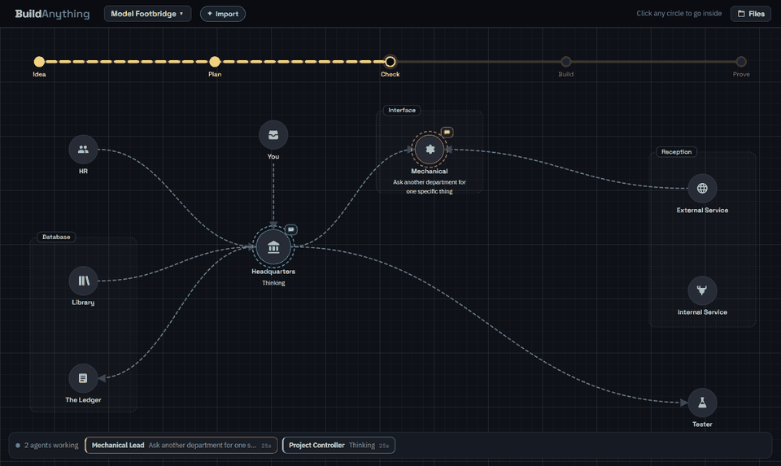
</p>

---

## Contents

- [Features](#features)
- [How it fits together](#how-it-fits-together)
- [User guide](#user-guide)
- [Proof: what was built and checked](#proof-what-was-built-and-checked)
- [Safety model](#safety-model)
- [Project layout](#project-layout)

---

## Features

### Departments that work side by side, and keep going

Headquarters runs the departments in parallel: while Mechanical works, it can start Software's job, and it waits only when there's nothing else to start. A department never runs two jobs at once. A request that arrives while it's busy waits its turn, so two jobs can't write over each other's work.

- **It doesn't stall.** For each stage, Headquarters drives the work behind every item you'll confirm, plus whatever a department said it still has to do itself. Your answers to a department's questions go back to it as a go-ahead to carry on. It stops and tells you after two rounds in a row that finish nothing.
- **Code in any language, checked by running it.** Software writes each program in the language its platform needs (Kotlin and Gradle for an Android app, Swift, C#, Lua, Python, TypeScript and so on), changing files with precise edits, like a patch, across several files at once. For each program it records a build command; once you allow it, the app runs that build and the tests after every write, and failures go straight back to the agent to fix. Python programs are also import-checked in a fresh Python.
- **Proposals come in batches.** Mechanical proposes all its parts in one go, and Electrical all its components. You can add them all with one click.
- **Every file counts.** Departments see everything in the project folder, including files you add yourself, such as a URDF exported from your CAD program.
- **One bad block doesn't sink a write.** Code is checked block by block: the blocks that pass are saved straight away, a failed edit keeps the block's previous version, and only the failed blocks go back to the writer with their problems. Rules that protect other departments' work (the frozen interface, the code layers) still stop the whole write.
- **Missing a tool?** A department asks Reception. External Service asks what you already have, looks for an established add-in or converter before writing anything new, guides you through setting it up, then writes a Skill so it's reused.

### Each department is defined by what it delivers

| Department | What it hands over |
|---|---|
| Mechanical | The physical design: CAD model, parts, assemblies, exports |
| Electrical | The circuit: components, connections, power, low-level drivers |
| Software | The product's own code, in any language, with its tests |
| **Simulation** | **Evidence that the design works before it's built:** runs and results judged against the requirements |
| Procurement | The buying list, prices and orders |

The **Simulation** screen opens on **Runs**: pick a run, watch its recording, and read its plots, results and what it assumed. Every run saves a recording, a summary and its assumptions, whatever simulator made it. The code sits under its own tab.

**Simulation** builds each simulation from the other departments' deliverables and uses them unchanged: Mechanical's model, Software's code, Electrical's circuit. It chooses the kind of simulation the requirement needs (physics, circuit, structural, thermal, anything else), runs it itself once you allow it, and saves results (data, plots, screenshots, recordings) where departments and tabs can show them. When a run measures what a test asks for, it proposes the result with its files on the **Tests** screen; you accept it, and the app judges the number against the limits. When a run fails, it tells the owning department with the numbers; it never patches their work. Headquarters adds Simulation only to projects that need it.

### Office hours: answers at once, work in batches

Every chat answers you straight away: Headquarters, each department's Lead and both Service agents. New work for the departments waits until you've finished a round, 60 seconds after your last action, so Headquarters can plan everything you decided in one pass and start the departments side by side instead of one small job per click.

- **Send now** starts what's waiting at once; **Hold** keeps everything until you press Send, for a long review. Pause and spending-limit changes always go through immediately.
- Results a department asked for, such as the output of scripts you approved, reach it together in one message, with a short follow-up briefing instead of the whole project again.
- When an agent needs you to decide something, it offers up to four numbered answers, its recommendation first. Click one, or choose **Other** and type your own.

### Change the plan by asking

Once the concept is approved, tell Headquarters' chat what you want changed, such as "the real arm must use a PCA9685". It puts the change on the Changes screen, an independent reviewer checks what it affects, and you approve or reject it. A new requirement you asked for is recorded in your own words. The Verifier's findings on the plan can each be fixed, kept for later, accepted or dismissed, and the plan is revised once they're decided.

### See who's working, and what they're thinking

The home canvas shows every agent that's running right now. A busy node gets a turning dashed ring in its own colour, a status bar along the bottom lists each agent with its current step and how long it's been running, and the speech-bubble button opens a live chat-style trail: the model's reasoning summaries, each tool it uses (and with what), and what it says.

| The canvas while two agents work | One agent's live trail |
|---|---|
|  |  |

### The Ledger: the story, and the project's memory

Every event is recorded. The **Story** tab replays it as a conversation between the team, showing only what agents and you said and decided (**Show automatic steps** adds the app's own checks, saves and reads), with timestamps and each department in its own colour. Click a message to read it in full. It always opens on the current step, and **Watch from step [n]** replays from any point until you press **Stop**. The **Memory** tab draws what the project knows as a graph (requirements, tests, design needs, parts, connections, code, decisions, sourced facts) and shows, for any item, what it depends on and what a change to it would affect.

| Story, with the conversation | Memory: what depends on what |
|---|---|
| 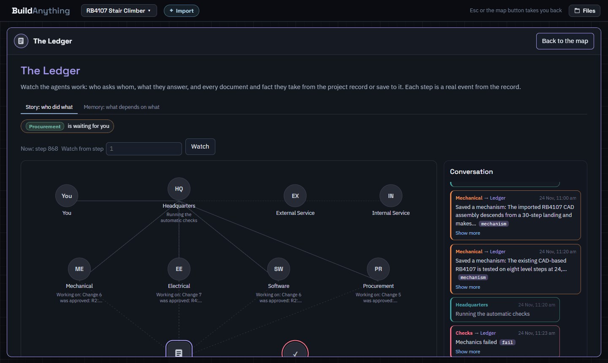 | 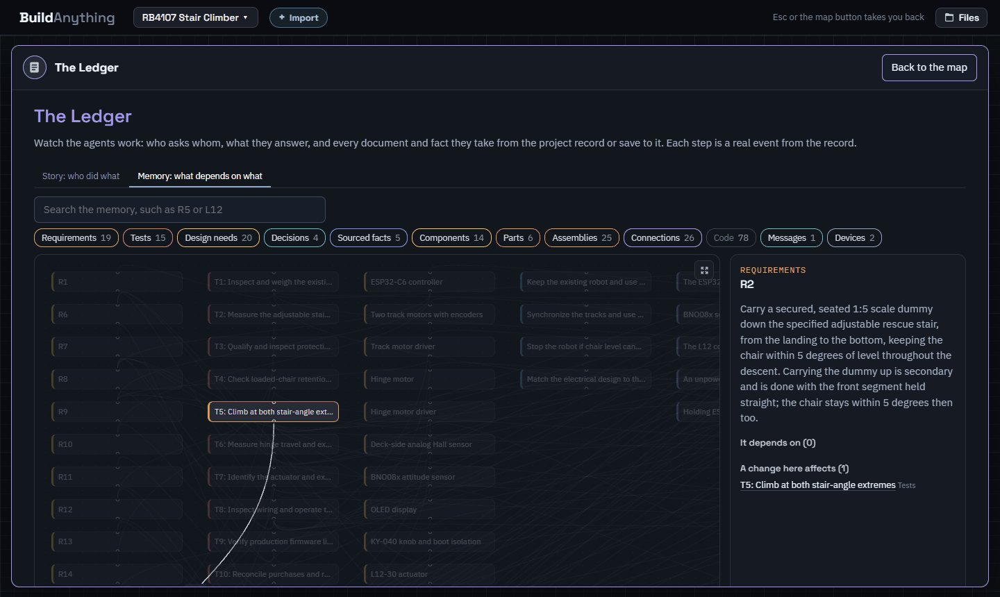 |

Headquarters shows the same conversation, compact, under **Between departments**:


### Tool tabs: any tool, in the department that uses it

Service agents can write a **tool tab**: a TSX tab in a department's screen that shows one tool's results for the open project. Guided by the built-in Tab-creator and Card-creator Skills, they can make a tab for any tool: CAD, physics simulation, PCB rule checks, MATLAB, data and plots. The app compiles each tab and runs it in a sealed frame with no network access and no access to the app's buttons. An optional data script runs in a sandbox, in the project's own Python environment, only if you switch tab scripts on. You approve each tab and choose which projects show it.

- **Where a tab goes:** by what each department delivers. Live runs and inspecting a simulation go in Simulation; the static results that bear on a department's own design (its plots, screenshots, data) go in that department; a tool that does both gets one in each.
- **Follows each project's files:** a tab finds files by type (any URDF, the newest results folder), not by one project's names. If a shown tab looks in places a project doesn't use while files of that kind exist elsewhere, Headquarters tells you and points to the Service agent that made it; a department is asked to make a file only when nothing like it exists.
- **Suggested, not imposed:** the app spots where a tab would help (connections with visual or debugging output, result files the programs saved) and the Service agents offer one. **Not needed** stops the suggestion.

| MuJoCo tab (replays the recorded run) | Fusion tab (exports in 3D, scripts to run) |
|---|---|
|  |  |

What a MuJoCo tab replays: recorded runs from two of the projects.

| Stair climber: 24° nose-first descent | Stair climber: 24° rear-first ascent | MA-6 arm: the poses checked |
|---|---|---|
| 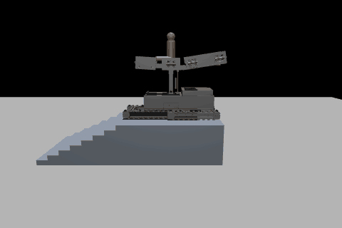 | 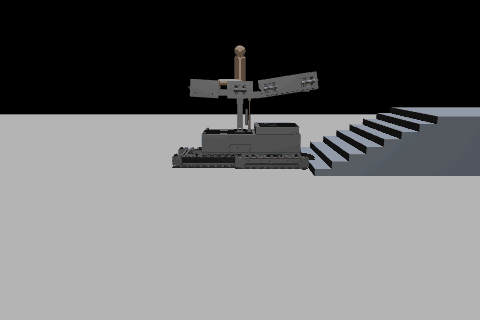 | 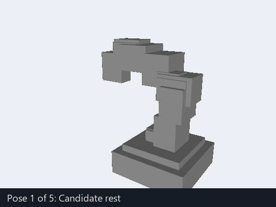 |
| The robot's main job: carrying the seat down while the levelling keeps it within 5°. | Going up, rear first, with the front segment held straight. | The bought kit's arm, rendered from its CAD model, in the poses used to check each servo's load. |

<sub>Both stair runs come from the Simulation Engineer's model, run in the app's sandbox (60 s each, shown at 4× speed). The arm is rendered from the kit's imported CAD model.</sub>

The examples that ship with the Skill: **Fusion**, **MuJoCo**, **KiCad** (ERC and DRC through kicad-cli), **MATLAB** (batch run, figures) and **data and plots** (CSV statistics).

### Connections: use any online service or MCP server

External Service connects the app to outside services, such as Altium 365 through Nexar, GitHub, supplier APIs and MCP servers:

- **Setup:** it researches the official documentation and proposes a connection: the address, how you sign in, setup steps, and a list of named actions, each marked *reads* or *changes something*.
- **Your part:** you approve it, then paste the key (or press **Sign in** for browser sign-in), and press **Test**.
- **Use:** department agents then call it by themselves. Reading runs at once; every change waits for your **Allow and send**. Tool tabs can show its data live.
- **Fewer interruptions:** a department can send up to eight steps in one request, which you approve once. **Allow, and don't ask again** lets one department run one action in one project without asking, until you switch it off under **Running without asking you**.
- **Learns how to use it:** what an error or your rejection taught an agent about a service is kept as a note, and every later job on every project sees it.

| A connection at External Service | A tab showing a connection's live data |
|---|---|
| 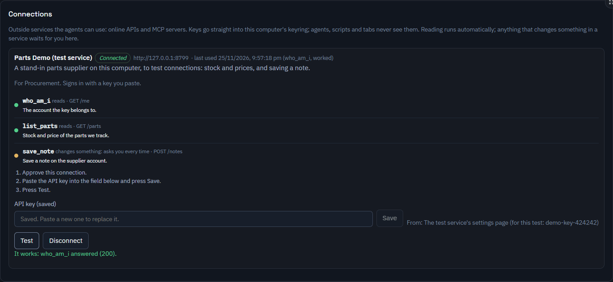 |  |

<sub>Shown against a stand-in service running on this computer, during testing.</sub>

### Reception: Skills, tool tabs, project environments

- **External Service** writes **Skills**: guides for programs you operate yourself, such as Altium, researched from official sources, checked by the app and an independent reviewer, and approved by you. It also keeps your AI provider settings.
- **Internal Service** looks after what the project's code needs on this computer: each project's own Python environment, and the programs and toolchains it builds and runs with (compilers, SDKs, build tools). It finds the official installer (winget, or an installer that's already here such as an SDK manager), you approve the definition and then each install, and the program is found straight away, without restarting the app.
- **Tool tabs** are reviewed, previewed, approved and shown per project here, with one switch for data scripts.
- **Requests from departments** for a tool they lack are listed for the Service agents, the open project's first. They aren't approvals: each closes when a Service agent answers it, its department finishes the job anyway, or you press **Close**.

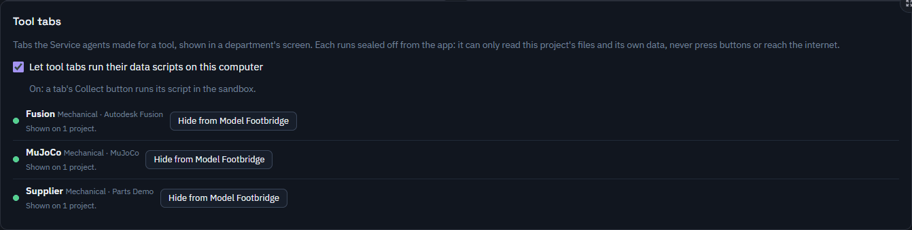

### Files, with viewers

A file explorer on the right, which you can drag to resize, lists everything in the project, with viewers for PDF, Markdown, JSON, XML, CSV and XLSX, and STL in 3D. For other types, the Platform agent can write a sandboxed converter, which you approve.

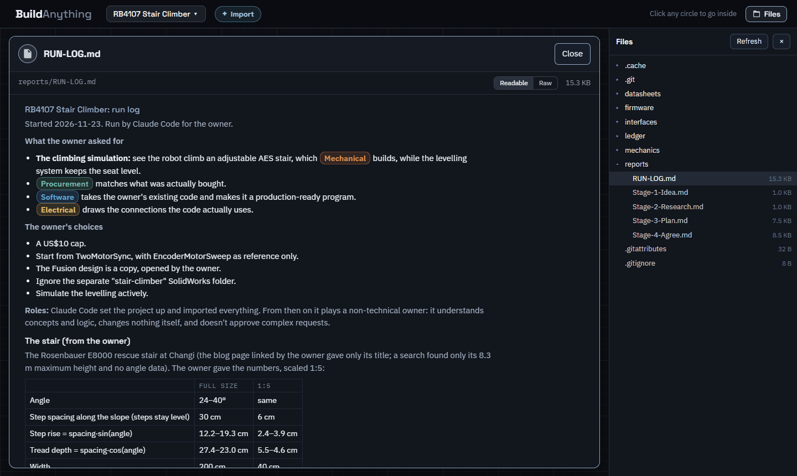

### A team shaped to the project

Headquarters proposes only the departments a project needs, and gates with their own criteria, instead of a fixed pipeline. Departments that aren't on the team are hidden. Switching projects closes any screen the new project doesn't have.

The CAD model is of the whole product: before Design finishes, every bought part that mounts or takes up space (motors, batteries, boards, casters) needs a body in it, as the maker's model or a block at its datasheet size, so fits are checked against real parts. Wire, screws and the like are exempt, and you can mark any part **Not needed** with a reason.

---

## How it fits together

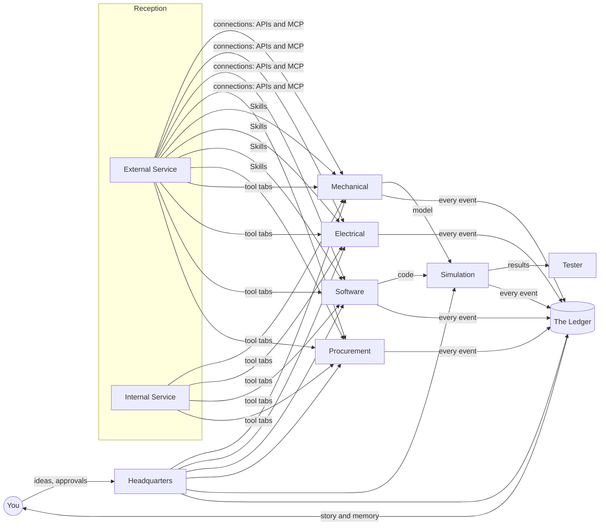

How an outside service is used:

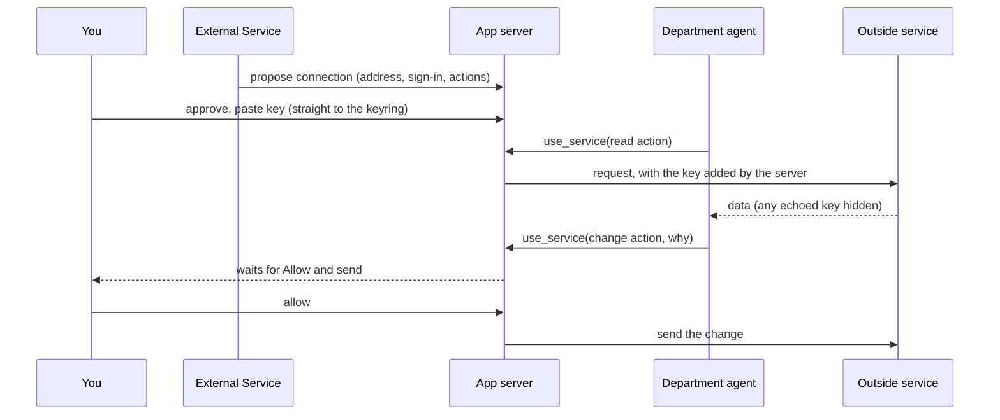

**Stack:** a React 18 + Vite app (`app/`), a FastAPI backend (`backend/`) running the agents through the OpenAI Agents SDK, with fastmcp for MCP and esbuild for tool tabs. Simulators, SDKs and build tools are whatever each project needs, installed into its own environment or onto the computer with your approval; none is part of the app. All data stays in local folders, and the servers listen on this computer only (127.0.0.1).

---

## User guide

### 1. Install

You need **Windows**, **Python 3.11+** with [uv](https://docs.astral.sh/uv/), **Node.js 20+** (built and tested on Node 22), and **Chrome or Edge**.

```bash
git clone https://github.com/Lynean/BuildAnything.git
cd BuildAnything

# Backend
cd backend
uv sync                      # makes .venv with the app's Python packages
cd ..

# App
cd app
npm install
npm run build
cd ..
```

### 2. Start it

**The easy way:** double-click **`start.bat`** (Windows), or run `./start.sh` (Git Bash, macOS or Linux). On the first run it sets up the backend and installs the app's packages; every time, it rebuilds the app, starts both servers and opens the browser. Close the two windows it opens (or press Ctrl+C for `start.sh`) to stop it.

**By hand:**

```bash
# Terminal 1: the backend, on this computer only
cd backend
.venv/Scripts/python -m uvicorn buildanything.api:app --host 127.0.0.1 --port 8787

# Terminal 2: the app
cd app
npx vite preview --port 4173 --host 127.0.0.1
```

Open **http://127.0.0.1:4173**. For development with hot reload, run `npm run dev` instead (port 5173). Projects are stored in `projects/` next to `app/` and `backend/`. Set `BUILDANYTHING_DATA` to use another folder.

### 3. Add your AI key

Open **External Service** → **AI providers and model tiers** and paste your provider key. It goes straight into Windows' keyring; agents never see it. Each project has its own spending limit.

### 4. Start a project

1. Open the project switcher at the top left → **+ New project**, or **Import** existing files.
2. In **Headquarters**, describe what you want to build. The Concept Partner drafts a concept; you approve it.
3. Headquarters proposes the **team** (departments) and the **gates** (what must be true before moving on). Change them if you like, then approve.
4. Open a department to talk to its lead. Its tabs group the work: **Lead** (the chat), the department's own tabs, any **tool tabs**, and **Capability** (its Skills, services and hand-offs).
5. Approve or reject what agents propose in **You** (the review queue), and tick gate criteria when they're met.
6. When Software or Simulation first writes a program, **Needs you** asks whether the app may run its code. Tick **Run code and tests** on that screen, and the department builds, tests and runs it itself, fixing what fails, instead of you running it.
7. To change the plan later, tell Headquarters' chat. The change waits on the **Changes** screen for your approval.
8. To take a project out of the app, use **⋯ → Disconnect this project** in Headquarters. Nothing on disk is touched; **Connect again** on the Headquarters start screen brings it back, paused.

### 5. Watch the team work

- **Home canvas:** busy nodes turn; the bottom bar lists who's working. Click a node's speech bubble, or a bar chip, to read its live reasoning.
- **The Ledger:** the full story and the memory graph. Type a step number and press **Watch** to replay from there; **Stop** returns to now.
- **Files** (top right): browse and read everything the agents wrote.

### 6. Connect a tool or service

| You want… | Ask | What happens |
|---|---|---|
| An online service (Altium 365, GitHub, a supplier API) or an MCP server | External Service: "connect Altium 365 for Electrical" | It proposes a connection. Approve it, paste the key or sign in, press **Test**. Agents can then use it; changes wait for you. |
| A program you operate yourself (Altium Designer, Fusion) | External Service: "write an Altium Skill for Electrical" | A verified guide for that department. The agent hands you scripts to run and you report back on **Capability**. |
| A tool's results inside a department | External or Internal Service: "make a MuJoCo tab for Mechanical" | It builds and checks a tab. Approve it at **Tool tabs**, choose the project, and switch on data scripts if it has one. |
| Python packages for a project | Internal Service: "install what the laptop code needs" | It proposes the packages; nothing installs until you approve. |
| A compiler, SDK or build tool | Internal Service: "set up what the Android app needs to build" | It checks what's installed, proposes each missing program with its official installer, and installs it once you approve. |

### 7. Run the tests

```bash
cd backend
.venv/Scripts/python -m pytest -q
```

---

## Proof: what was built and checked

Everything below was built and verified in this repository's latest work, in the real app in a browser, using scratch copies of real projects (a model footbridge, a stair-climbing robot, a desk LED strip):

| Feature | How it was checked |
|---|---|
| Live work on the canvas | Two running agents showed rings, talk buttons, the status bar and a live trail updating every 1.5 s. |
| Ledger story, chat and Watch | Opens at the current step (107 of 107); Watch from step 5 replays from 5; Stop returns to 107; chat bubbles stay within half the screen and wrap. |
| Memory graph | Built from each project's own record. On the stair climber: 19 requirements, 15 tests, 20 design needs, 14 components, 26 connections, 78 code blocks; choosing an item shows what a change affects. |
| Tool tabs | The five example tabs compile and pass the rules. The MuJoCo data script replayed the footbridge's recorded run in the sandbox (3 pictures, 1.2 s). Writing into the project and network access were both refused. A render check catches crashes, blank tabs and anything spilling out sideways. |
| Sealed frames | A network request from inside a tab is blocked; tabs only get answers to five read-only questions. |
| Connections | Approve, save key, **Test** ("who_am_i answered (200)"); an agent read data; a change waited for **Allow and send**, then went through (201); a tab read live data. The keys stayed in the keyring and were never written to the record. |
| Person-only actions | The tests caught, and fixed, a case where an agent's refused attempt to save a key still reached the keyring. Approving, keys, disconnecting and allowing changes are now checked before anything happens. |
| A full project run (RUA assistant arm) | A review run, with the reviewer acting only as the owner: the agents loaded the real 6-joint arm in MuJoCo from its URDF with all 82 meshes, reached commanded poses with 0° error, built a handover controller whose simulation tests prove the slow approach and the 10 cm stop, and wired it into a desktop app, with 91 tests passing. The pain points it found were fixed afterwards. |
| A project in another language (phone air mouse) | A review run planned an Android-to-Windows air mouse: 13 requirements, all for Software, with Bluetooth serial and a replay check. It stopped where the code writer couldn't yet write Kotlin; that's what led to programs in any language, build commands and toolchain installs. |
| A full project run (desk RC car, Fusion) | A review run took a phone-driven car from concept to the Check stage: parts and circuit chosen, datasheets fetched, joints rebuilt in Fusion and exported to URDF, and the car driven in MuJoCo before building (0.37 m/s straight, turns both ways, braking compared with coasting). Its pain points, from stalled exports to costly approval loops, became the office hours, block-by-block checks, whole-product CAD, project-following tabs and the other changes above. |
| Backend tests | **789 passing** (`pytest`), including tool tabs, connections (against a local stand-in service, client-credentials sign-in and an MCP server), agent trails, parallel Headquarters, the code writer's checks, programs in other languages and their builds, the Simulation department and toolchain installs. |

**Not yet tried:**
- **This round's changes in a full run:** office hours, numbered choices, block-by-block checks, batched and trusted requests, the Runs view and whole-product CAD pass their tests and were checked against the RC car's real files, but no agent has worked through them in a complete project yet.
- **The newest pieces in a full run:** the Simulation department, building a program in another language end to end (such as an Android app with Gradle), and installing a toolchain through Internal Service all pass their tests but haven't been through a complete project yet.
- **The latest fixes in a full run:** parallel Headquarters driving the stage work, automatic tests and batch proposals pass their tests, but haven't been through a complete project yet.
- **Real services:** connections haven't run against a real online service. The Altium 365 example uses Nexar's documented sign-in addresses and scopes, but whether Nexar accepts the app's local sign-in return address isn't confirmed.
- **Agents writing tabs and connections:** no agent has written a tab or a connection by itself yet. The examples were put through the same build and approval path.
- **Reasoning summaries:** these appear only when the model gives one.

---

## Safety model

- **You decide:** agents propose; only you approve concepts, gates, Skills, tool tabs, connections, installs, flashing, spending, test results and every change sent to an outside service.
- **Running code:** agent-written code, builds and simulations run on this computer only for programs where you ticked **Run code and tests**, from their own folder, with a time limit, and never through a shell.
- **Keys:** they go from you straight to Windows' keyring. No agent, script or tab ever sees one; the app's server adds them to requests and hides them if echoed back.
- **Sealed tool tabs:** a sandboxed frame with no network and no access to the app. Data scripts run in a sandbox: no network, no writing into the project, no secrets, and only the one program you approved.
- **Narrow connections:** a request can only go to the approved address, for an approved action. Placeholders are escaped so they can't change where a request goes.
- **Local:** projects stay in local folders; the servers listen on 127.0.0.1 only.

---

## Project layout

```
app/                React + Vite front end
  src/              screens (World.tsx is the home canvas), LiveWork, ToolTab, ConnectionsAdmin, ...
  src/tab-sdk/      the SDK tool tabs are compiled against (@ba/tab, @ba/model)
backend/
  buildanything/    FastAPI app, agents (agent_specs.py), Headquarters, Ledger, gates
    cloud.py        connections to online APIs and MCP servers
    tabs.py         tool tabs: build, checks, sandboxed data scripts, approvals
    builtin_skills/ Tab-creator, Card-creator and Service-connector Skills, with examples
  tests/            pytest suite
start.bat, start.sh  set up on first run, rebuild the app, start both servers and open the browser
docs/images/        the pictures in this README
PLAN.md             the original plan
```
